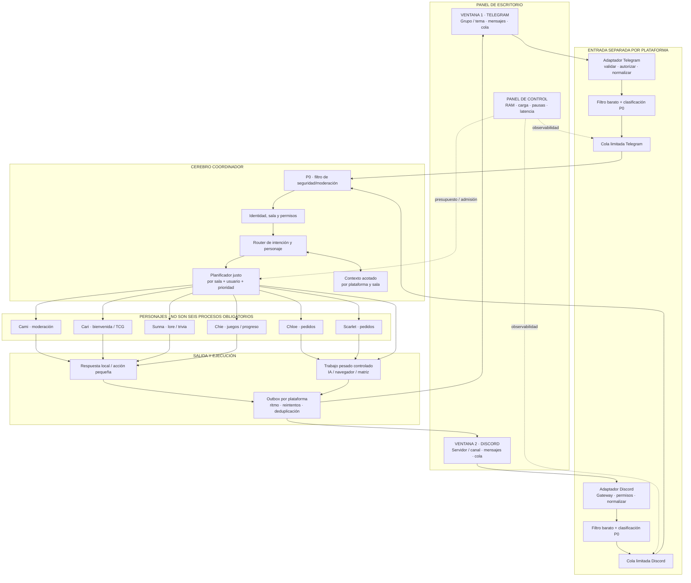

# BOT-IA — Plano conceptual de Telegram + Discord + Cerebro

**Estado:** mapa conceptual + motor de control aislado; Discord y la ruta compartida de mensajes siguen sin integración completa ni prueba de carga.  
**Rama:** `feat/dual-platform-cerebro-architecture-2026-10-21`  
**Regla de evidencia:** el panel visible no demuestra que un personaje esté ejecutándose; una conexión comprobada tampoco demuestra que el bot ya procese mensajes.

## 1. Objetivo visual

La interfaz de escritorio tendrá tres zonas conceptuales:

1. **Sala Telegram:** mensajes, grupo/tema seleccionado, conexión, cola y latencia.
2. **Sala Discord:** mensajes, servidor/canal seleccionado, conexión, cola y latencia.
3. **Cerebro + panel de personajes:** un coordinador común que recibe eventos de ambas plataformas, aplica seguridad, elige el personaje adecuado y concede permiso para ejecutar trabajo según prioridad y presupuesto de recursos.

Los chats permanecen separados. La zona del cerebro comparte la coordinación, no el contenido privado entre comunidades.

## 2. Qué hace cada zona

### Ventana Telegram

- Muestra el grupo y, si corresponde, el tema de foro seleccionado.
- Cada evento conserva la identidad de Telegram, el chat, el tema, el identificador del mensaje y el identificador único del update.
- La ruta de salas y las listas autorizadas existentes siguen siendo autoridad; la interfaz no puede conceder acceso por sí sola.
- El adaptador actual ya contiene piezas de parsing, seguridad, moderación, ledger de eventos y outbox. No se debe reemplazar su idempotencia ni su lógica de entregas por un segundo sistema paralelo.

### Ventana Discord

- Muestra servidor, canal e hilo seleccionado.
- Tendrá su propio adaptador de eventos, validación de permisos, deduplicación y outbox; no debe reutilizar identificadores de Telegram como si fueran equivalentes.
- Debe respetar los intents autorizados y los límites de la API. Discord documenta Gateway como conexión de eventos en tiempo real y recomienda seguir los límites dinámicos de la API, procesando `retry_after`/encabezados en lugar de asumir cuotas constantes.
- **Pendiente de implementación real:** el código revisado incluye un chequeo de identidad/conexión de Discord y estructuras de creación de salas, pero no se ha verificado un receptor de mensajes end-to-end. La ventana no debe marcarse «operativa» hasta completar y probar ese adaptador.

### Cerebro central

El cerebro no es otra persona que hable todo el tiempo. Es el coordinador que recibe eventos ya normalizados por adaptadores. Antes de las cuotas ordinarias, cada adaptador debe validar longitud/estructura y permisos del destino, rechazar eventos de bots y ejecutar la clasificación determinista barata de seguridad. Las detecciones con acción de moderación se encolan como P0.

Después, el coordinador:

1. vuelve a comprobar autorización antes de cualquier efecto;
2. trata los duplicados mediante el ledger durable de la plataforma;
3. atiende primero el trabajo P0/P1;
4. clasifica la intención y selecciona un personaje responsable;
5. consulta solo el contexto imprescindible de esa plataforma y sala;
6. solicita admisión de recursos para trabajo no esencial;
7. reserva un único portavoz por sala/turno;
8. comprueba que la tarea sigue vigente y entrega por la salida de la misma plataforma.

El cerebro no debe unir historiales de Telegram y Discord por defecto. Son dominios de contexto diferentes. Solo se compartirán resúmenes entre plataformas mediante una opción explícita, autorizada y auditable.

## 3. Responsabilidades de los seis perfiles

| Perfil | Función principal | Cuándo recibe trabajo | Regla para evitar conflictos |
|---|---|---|---|
| **Cami** | Moderación, seguridad, orden | Filtro prioritario en los eventos entrantes; revisión adicional solo si hace falta | Las alertas de seguridad prevalecen sobre charla, juegos y lore. El filtro léxico actual no equivale a moderación perfecta ni a inspección visual completa. |
| **Cari** | Bienvenida, atención y coordinación social | Saludos, preguntas sobre el café, TCG/Waifu según ruta existente | No debe responder también cuando ya hay otro personaje asignado a esa misma conversación. |
| **Sunna** | Lore, trivia y continuidad | Preguntas de contexto o lore identificadas por el router | Recibe solo la pregunta y el resumen de contexto relevantes, no el historial completo de ambas plataformas. |
| **Chie** | Juegos, XP, recompensas y actividad | Acciones explícitas de juego o eventos de progreso admitidos | P3; se suspende primero cuando hay presión de memoria o spam. |
| **Chloe** | Perfil de personaje y pedidos existentes | Solicitud concreta que corresponda a su flujo | Es un perfil de GUI; no debe mostrarse como trabajador de la matriz web si no está configurada allí. |
| **Scarlet** | Perfil de personaje y pedidos existentes | Solicitud concreta que corresponda a su flujo | Igual que Chloe; no se le debe iniciar automáticamente para cada mensaje. |

Se conservan las seis fichas visuales, pero la cantidad de fichas **no** determina cuántos procesos hay activos. En el código revisado solo Cari, Cami, Sunna y Chie figuran en `MATRIX_BOT_SPECS`; Chloe y Scarlet no están configuradas allí.

## 4. Política de admisión y prioridades

Cada mensaje no debe abrir una consulta costosa de IA. Primero se procesa por reglas deterministas y luego se decide si necesita una respuesta.

| Prioridad | Trabajo | Comportamiento bajo carga |
|---|---|---|
| **P0** | Moderación y seguridad | Conservar presupuesto reservado y ruta rápida. El control de recursos no debe bloquear la detección esencial. |
| **P1** | Comandos críticos, permisos y acciones administrativas | Se atienden antes que el trabajo ordinario; requieren autorización. |
| **P2** | Preguntas dirigidas, conversación y pedidos ordinarios | Cola limitada; se puede aplicar cooldown, resumen o respuesta de espera. |
| **P3** | Minijuegos y actividad secundaria | Suspender primero cuando se acumula cola o memoria. |
| **P4** | Matriz de varios personajes, navegación pesada, resúmenes no urgentes | Ejecutar cuando hay capacidad y cola baja; nunca competir con P0/P1. |

Reglas obligatorias para el planificador:

- Una conversación/sala tiene **un solo personaje portavoz por turno**, mediante una reserva temporal (speaker lease). Otros personajes pueden ayudar como tareas internas, pero no enviar respuestas públicas paralelas.
- Una solicitud normal dispara cero o una llamada costosa de IA, nunca seis llamadas por tener seis fichas.
- Duplicados, respuestas del propio bot, eventos retransmitidos y reintentos deben detectarse antes de reingresar a la cola.
- Las colas son limitadas. Cada tarea tiene fecha de caducidad; una pregunta antigua o un juego atrasado puede descartarse o resumirse en vez de ejecutarse cuando ya perdió utilidad.
- Se garantiza equidad por plataforma, sala y usuario para que una sola sala ruidosa no consuma toda la capacidad.
- Los envíos tienen una outbox por plataforma y respetan los límites del proveedor; un error de cuota aplica espera/reintento controlado, no un bucle de reintentos.
- La saturación no debe producir mensajes de error por cada tecla. Se envía un aviso breve por sala y periodo, y el panel registra el volumen descartado/agrupado.

## 5. Qué chocaría con qué y cómo se evita

| Colisión probable | Efecto | Protección propuesta |
|---|---|---|
| Cami detecta un problema mientras Cari/Sunna responde | La respuesta social podría pisar la de seguridad | P0 precede al router; suspender respuestas ordinarias a la misma incidencia y usar reserva de sala. |
| Los seis personajes contestan al mismo mensaje | Spam del propio bot, contradicciones y seis costes de IA | Un portavoz por turno; selección de rol y máximo de una respuesta pública normal por evento. |
| Telegram se inunda y ocupa toda la cola | Discord deja de responder, o viceversa | Colas de ingreso separadas, límite por sala/usuario y reparto justo en el planificador global. |
| Una pregunta tarda mientras llegan mensajes nuevos | La respuesta aparece tarde o fuera de contexto | TTL, cancelación lógica, verificación de que la tarea sigue vigente antes de enviar y resumen acotado. |
| La misma persona escribe en ambas plataformas | Se mezclan identidades o historiales | Identidades separadas por proveedor; vinculación solo explícita. Sin esa vinculación, no se presume que sea la misma persona. |
| Un mensaje se reintenta después de un fallo | Acción repetida, pedido duplicado o doble recompensa | Clave de idempotencia por plataforma/evento y persistencia antes de producir efectos. |
| Dos acciones necesitan el mismo navegador físico | Colisión de sesiones o uso concurrente del mismo recurso | Mantener la autoridad física existente; navegador único en cola exclusiva. La cola lógica no reemplaza al bloqueo físico. |
| Juegos, navegador e IA consumen la RAM al mismo tiempo | Moderación lenta, GUI congelada o memoria excedida | Presupuesto compartido, muestras válidas, P4/P3 se frenan antes y concurrencia pesada limitada. |
| La API limita los mensajes salientes | 429, retrasos o bloqueo temporal | Outbox separada, leer el tiempo de espera del proveedor, backoff y límite por sala. |
| El bot reacciona a sus propios mensajes o a un puente entre plataformas | Bucle de respuestas Telegram ↔ Discord | Ignorar autores-bot, marcar origen y correlation_id, y no retransmitir mensajes automáticos por defecto. |
| Escrituras SQLite simultáneas | Esperas de bloqueo y retrasos | Reutilizar ledgers/outboxes existentes y limitar transacciones cortas. Medir contención antes de añadir más bases de datos. |
| Un usuario intenta inundar el sistema con comandos costosos | Agotamiento de cuota o trabajo atrasado para los demás | Límite por usuario, cooldown por acción y cupo justo; los eventos se clasifican antes de llamar a IA. |

## 6. Prueba de estrés conceptual: 100 personas por sala

Son **200 personas en total**, pero el número de personas por sí solo no determina el consumo. Lo que importa es la frecuencia de los eventos y qué porcentaje dispara trabajo costoso.

| Escenario de cálculo | Ritmo supuesto por persona | Entrada combinada estimada | Resultado esperado del diseño |
|---|---|---:|---|
| Conversación tranquila | 1 mensaje cada 2 minutos | ~100 eventos/min (~1,7/s) | Procesamiento normal; no toda charla genera una llamada de IA. |
| Chat activo | 1 mensaje cada 20 segundos | ~600 eventos/min (10/s) | Reglas rápidas, colas justas, respuestas por mención/comando/intención y tareas pesadas limitadas. |
| Inundación automatizada | 5 mensajes por segundo | ~60.000 eventos/min (1.000/s) | No es carga a prometer en un PC local. Activar límites de ingreso, descartar spam/no prioritario, proteger P0 y mostrar degradación explícita. |

Estos ritmos son **escenarios de cálculo**, no pruebas de rendimiento realizadas sobre este repositorio.

En el escenario activo, llamar a un modelo de IA por cada evento implicaría 600 solicitudes/minuto. Si, además, cada evento activara los seis perfiles, serían 3.600 trabajos de personaje por minuto antes de contar reintentos, navegación o respuestas. El diseño debe impedir ese patrón.

En una inundación de 1.000 eventos/s el sistema de escritorio no puede prometer atención individual en tiempo real. La conducta correcta es degradarse de manera controlada: filtrar/rechazar spam, respetar permisos y límites de plataforma, dejar las tareas no esenciales en espera o descartarlas por caducidad y no fingir que todo fue procesado.

### Respuesta definida cuando la cola crece

- **Normal:** se permite trabajo P0–P4 según la política de recursos y tareas.
- **Advertencia:** no se admite P4 pesado nuevo; se mantiene el trabajo prioritario.
- **Presión alta:** P3 se pausa y se restringe P2 nuevo.
- **Crítico o sensor desconocido/obsoleto:** solo rutas esenciales P0/P1; otras tareas esperan, caducan o reciben una respuesta local de indisponibilidad.
- **Cola desbordada:** eliminar o agrupar eventos no esenciales con regla explícita; nunca borrar silenciosamente una acción crítica ni afirmar que fue completada.

Las etapas de recursos siguen siendo admisión de trabajo, no un límite duro del sistema operativo ni una forma de matar procesos ya activos. La cancelación física debe definirse y probarse por separado.

## 7. Qué mostraría el panel

Por cada plataforma:

- estado de conexión real (conectado, desconectado, degradado o no implementado);
- mensajes recibidos por minuto;
- profundidad y antigüedad del mensaje más viejo en la cola;
- P0/P1 pendientes, P2/P3/P4 pausados;
- tiempo hasta primera respuesta;
- errores, duplicados, eventos caducados y respuestas limitadas por API.

Por cada personaje:

- función, tareas admitidas, cola pendiente y estado (disponible, ocupado, pausado, fallido, no configurado);
- última acción real y resultado, sin deducir «activo» por el simple hecho de mostrar su tarjeta.

En el área central de cerebro:

- sala/plataforma seleccionada;
- intención detectada, personaje portavoz, prioridad y motivo de la decisión;
- reserva de sala y tarea actual;
- RAM medida, vigencia de la medida y política aplicada;
- un registro de auditoría de «recibido → clasificado → admitido/denegado → ejecutado → enviado».

El mando de memoria regula el presupuesto local compartido; no crea recursos, no garantiza que el proceso quede por debajo del número elegido y no debe desactivar la ruta P0 de moderación.

## 8. Orden de implementación propuesto

1. **Contrato y mapa (este documento):** acordar eventos, responsabilidades, prioridades y puntos de observabilidad.
2. **Verificar y construir adaptador Discord real:** recibir mensajes, validar permisos, deduplicar y enviar por outbox; comprobar intents y configuración real del bot.
3. **Extraer el contrato común de evento sin romper Telegram:** conservar el ledger, routing, autorización y outbox actuales.
4. **Planificador compartido con aislamiento de colas:** límites, equidad, caducidad, portavoz único y admisión por recursos.
5. **Integrar el panel de dos ventanas:** primero mostrar salud, colas y estado real; después habilitar controles que tengan rutas ejecutables.
6. **Pruebas por etapas:** duplicados, dos plataformas, colisión de personajes, 100 usuarios simulados, inundación controlada, reinicio y recuperación. Separar pruebas simuladas de pruebas reales con Telegram/Discord.
7. **Validación de Windows y RAM:** recoger mediciones reales en el PC antes de afirmar objetivos de capacidad.

No se modifica la autoridad física de WebChat, QWebEngine, TaskEngine ni TaskScheduler como parte de este plano. La integración Discord y la prueba con 100 usuarios no se consideran terminadas solo porque exista este documento.

## 9. Referencias técnicas externas

- Telegram Bot API: https://core.telegram.org/bots/api
- Telegram Bots FAQ, recepción de mensajes y límites de salida: https://core.telegram.org/bots/faq
- Discord Gateway: https://docs.discord.com/developers/events/gateway
- Discord API rate limits: https://docs.discord.com/developers/topics/rate-limits
- Discord privileged intents: https://support-dev.discord.com/hc/en-us/articles/6207308062871-What-are-Privileged-Intents

## 10. Implementación de control de comunidad en esta rama

Se añadió una primera implementación aislada del contrato común:

- Código: src/bot_ia/core/community_control.py
- Pruebas escritas: tests/test_community_control.py
- Normativa de operación: docs/architecture/COMMUNITY_CONTROL_POLICY.md

El motor dispone de dos perfiles de cola: **Medio** por defecto (256 eventos por plataforma, 32 reservados para P0/P1, tope de 80 por sala y de 5 por usuario dentro de una sala; 6 admisiones ordinarias por usuario cada 10 segundos) y **Bajo en recursos** (128 por plataforma, 24 reservados, 32 por sala, 3 por usuario por sala y 3 admisiones ordinarias por usuario cada 10 segundos). El trabajo P2/P3/P4 caduca cuando queda anticuado; los P0/P1 no caducan por TTL, pero están sujetos a la capacidad crítica limitada.

La política incluye deduplicación por plataforma + evento, rechazo de mensajes identificados como enviados por bots, reserva de portavoz única por sala, planificación por prioridad y reparto rotativo entre plataformas/salas/usuarios en la misma prioridad. No añade dependencias de terceros ni crea procesos de servicios externos.

**Límite crítico:** la cola y las reservas viven en memoria del proceso, y los adaptadores actuales todavía no llaman al motor. Por lo tanto, todavía no gobierna el tráfico real y no sustituye al ledger/outbox durables, a la autorización específica de cada plataforma ni al Resource Governor. Los adaptadores deben clasificar seguridad de forma determinista antes de cuotas ordinarias y aplicar la política de RAM al retirar trabajo P2/P3/P4.

Los tests están escritos, pero no ejecutados en esta sesión; no se ha creado una ejecución CI porque eso volvería a abrir el gate general que contiene el bloqueo protegido de QWebEngine. Discord sigue sin estar probado como adaptador real de mensajes y no hay prueba de carga con 100 usuarios.
